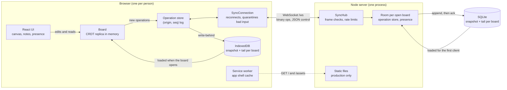
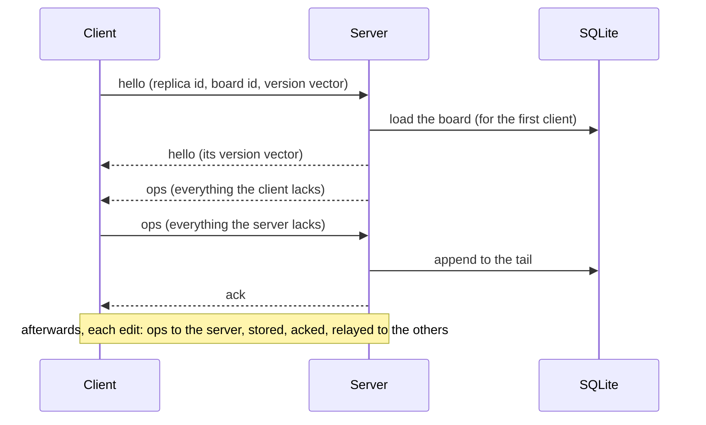

# driftboard

A local-first collaborative sticky-note board. Everyone who has the link sees the same board and can
edit it at the same time, with or without a network. See [DESIGN.md](DESIGN.md) for the details
behind this page, [PERFORMANCE.md](PERFORMANCE.md) for measurements, [CRDT-REVIEW.md](CRDT-REVIEW.md)
for a sceptical review of the CRDT library, [ROADMAP.md](ROADMAP.md) for what is left to do, and
[AGENTS.md](AGENTS.md) for commands and contribution rules.

- [Quick start](#quick-start)
- [What local-first means here](#what-local-first-means-here)
- [Architecture](#architecture)
- [How the CRDTs work](#how-the-crdts-work)
- [The sync protocol](#the-sync-protocol)
- [Running it in production](#running-it-in-production)
- [How it is tested](#how-it-is-tested)
- [Status](#status)
- [Known limitations](#known-limitations)
- [License](#license)

## Quick start

```sh
corepack enable        # uses the pnpm version pinned in package.json (Node 22.12, see .nvmrc)
pnpm install
pnpm check             # lint + typecheck + tests
pnpm e2e:install       # once: Playwright's Chromium, into this folder
pnpm check:all         # pnpm check, then the end-to-end suite (pnpm e2e)
```

Run the app for development (two terminals, loopback only):

```sh
pnpm --filter @driftboard/server dev   # sync server, ws://127.0.0.1:22100/ws
pnpm --filter @driftboard/web dev      # web client, http://127.0.0.1:22101
```

Open the web client and choose _Create a board_. **The link is the only key to the board**: open it
in another tab or browser to edit together. Double-click the background to add a note, drag a note by
its header, scroll to pan and Ctrl/Cmd + scroll (or pinch) to zoom. Ctrl/Cmd+Z undoes your last
change and Shift+Ctrl/Cmd+Z redoes it; undo only reverses _your own_ changes, never what others did.
The bar shows _Online_, _Syncing…_ or _Offline_ with the number of pending changes, who else is here,
and where their pointers are.

For one process that serves the page, the WebSocket and the health check from a single port, see
[Running it in production](#running-it-in-production): `pnpm start:prod`, or `docker compose up`.

## What local-first means here

The board belongs to the device that has it open, and the server is a convenience.

1. **The copy on your device is the real one.** A board is a replica held in the page (a `Board`
   object from `packages/crdt`) and in IndexedDB. Opening a board you have seen before needs no
   network: it is read from disk before anything connects. The app is a PWA, so after one visit the
   page itself opens offline too (checked by hand in Chromium with the network cut: a reload, and a
   link opened cold in a second tab, both show the board; this is not an automated test).
2. **Edits never wait.** Typing, dragging and deleting change the local replica at once and return
   the _operations_ that describe the change. Sending them is a separate, later step. Nothing in the
   editing path asks the server.
3. **Sync is merging, not choosing.** Replicas exchange operations that commute: applied in any
   order, any number of times, they give the same board. There is no conflict dialog and no "last
   save wins": two people typing in the same note keep both texts, and a note one person deletes
   while another is editing stays (the edit wins).
4. **Offline is just a long delay.** Operations made offline are stored on disk with a number
   (`origin`, `seq`). On the next connection each side says exactly what it holds (a version vector)
   and the other sends exactly the rest, even if that is a week of edits, or edits made by earlier
   page loads of the same device.
5. **The server is a relay and a durable log.** It checks and stores operations, tells other clients,
   and keeps each board's log in SQLite. It never merges anything itself: it holds no copy of the
   board, only the operations, and clients do the merging. A server that is down stops people from
   seeing each other, not from working.

What it does _not_ mean: there are no accounts and no end-to-end encryption (the board id is an
unguessable capability, and the server can read every board); there is no peer-to-peer link (clients
only talk to the server); a first visit needs the network; and history is never discarded
(see [Known limitations](#known-limitations)).

## Architecture



| Part             | Where               | Job                                                                                                                                                                                      |
| ---------------- | ------------------- | ---------------------------------------------------------------------------------------------------------------------------------------------------------------------------------------- |
| CRDT library     | `packages/crdt`     | Clocks, version vectors, the register, the map, the text sequence, the `Board` and undo. Pure: no I/O, no clock, no randomness of its own.                                               |
| Sync protocol    | `packages/protocol` | Message formats (zod), the binary encoding of operations, the operation store with its rules, one connection's state machine and the server's `Room`. All pure functions on plain state. |
| Server           | `apps/server`       | `ws` WebSockets (one room per board), `GET /healthz`, SQLite through better-sqlite3, optional static files.                                                                              |
| Web client       | `apps/web`          | React 18 + Vite. Framework-free logic in `src/lib` (text diff, caret, board store, sync connection, storage); thin React in `src/components`.                                            |
| End-to-end suite | `e2e`               | Playwright: the real server, the production web build and 2–3 browser contexts per test.                                                                                                 |
| Benchmarks       | `bench`             | The scenarios behind `PERFORMANCE.md`.                                                                                                                                                   |

Workspace packages are consumed from TypeScript source (`exports` points at `src/index.ts`); the
server runs through `tsx`.

**Data model.** A board is a map from note ids to notes. A note has a position `x`, `y`, a colour, a
stacking order `z`, and a text. Nothing else is replicated. Who is here and where their pointers are
(_presence_) is ephemeral: relayed, never stored, and sent at most 20 times a second.

| What                          | Replicated as                                                | Concurrent changes…                                               |
| ----------------------------- | ------------------------------------------------------------ | ----------------------------------------------------------------- |
| Which notes exist             | add-wins map                                                 | a delete never undoes an edit made at the same time               |
| A note's `x`/`y`, colour, `z` | last-writer-wins registers (`x` and `y` share one timestamp) | the later write wins, per field; a move is never torn             |
| A note's text                 | text sequence (the Fugue tree)                               | both insertions stay, whole, and the order is the same everywhere |
| Undo and redo                 | new operations that reverse your own changes                 | never touch what others did                                       |

## How the CRDTs work

A CRDT here is a rule for applying operations that gives the same result whatever order they arrive
in, and however often. Each example below is a test (`packages/crdt/src/readme-examples.test.ts`), so
what the comments say is what the code gives.

### Time and identity: hybrid logical clocks, ids, version vectors

Every write needs an order that all replicas agree on, and wall clocks disagree. A **hybrid logical
clock** (HLC) gives each write a timestamp `(wallMs, logical, replicaId)`: the wall time when it is
later than anything seen, else the largest time seen with a counter added. A replica that receives a
timestamp moves its clock past it, so a write made after reading another is always later. The
replica id breaks exact ties, so timestamps are unique and totally ordered. The library never reads
a clock itself: the caller passes one in (`createManualClock` in tests).

Every operation has an **id**: `counter@replicaId` (`3@alice` is alice's third). A **version vector**
maps each replica to the highest counter seen from it, and says exactly which operations a replica
holds. Operations from one replica are applied in order, so "counter 3 seen" means "1 and 2 seen".

```ts
const mine = VersionVector.from([
  [alice, 3],
  [bob, 1],
]);
const theirs = VersionVector.from([[alice, 2]]);
mine.compare(theirs); // 'after': I hold everything they hold, and more
mine.includes(opId(3, alice)); // true;  theirs.includes(opId(3, alice)) is false
```

### LWW register: one value, the latest write wins

Used for each note's `x`, `y`, `z` and colour. A register keeps the value with the greatest
timestamp; applying a write that is older, or the same one again, changes nothing.

```ts
const alice = new HybridLogicalClock({
  replicaId: replicaId('alice'),
  physicalClock: createManualClock(1000),
});
const bob = new HybridLogicalClock({
  replicaId: replicaId('bob'),
  physicalClock: createManualClock(1000),
});

const title = LwwRegister.empty<string>();
const aliceWrites = title.prepareSet('Groceries', alice.tick());
const bobWrites = title.prepareSet('Errands', bob.tick()); // the same millisecond

title.apply(aliceWrites).apply(bobWrites).value; // 'Errands'
title.apply(bobWrites).apply(aliceWrites).value; // 'Errands': the tie goes to 'bob' > 'alice'
```

Moving a note writes `x` and `y` with **one** timestamp, so two people dragging at once end with one
person's position, never `x` from one and `y` from the other.

### Add-wins map: which notes exist

A map from keys to values where a key is present while at least one **write** of it survives. Every
write carries a unique id (its _dot_) and the dots of that key it had seen, which it replaces. A
delete removes only the dots it had seen. So a write that happens at the same time as a delete is not
among the dots the delete knew about, and survives: _add wins_. Values that survive together (two
concurrent writes) are joined, here by the per-field LWW rule. No tombstones are kept: the version
vector is the memory of what was removed.

```ts
const empty = AwMap.empty<string>(join); // join: how surviving values combine
const shared = empty.apply(empty.prepareSet(alice, 'note-1', 'buy milk')); // both replicas have this

const rewrite = shared.prepareSet(alice, 'note-1', 'buy oat milk'); // alice rewrites it...
const remove = shared.prepareRemove('note-1'); // ...while bob deletes it

shared.apply(rewrite).apply(remove).get('note-1'); // 'buy oat milk'
shared.apply(remove).apply(rewrite).get('note-1'); // 'buy oat milk': add wins, in either order
shared.apply(remove).has('note-1'); // false: a delete removes what it saw
```

### Text sequence: the Fugue tree

Text is the hard case: two people typing at the same spot must both keep their text, and not have it
interleaved letter by letter. Every character is a **node** with a unique id. An insert says which
node it hangs off (`parent`) and on which side (`left` or `right`); the document is the in-order walk
of the tree, with the children of a node on one side ordered by id. A run typed by one person is a
chain, so it stays together whatever else is inserted around it. A delete does not remove the node:
it marks it a **tombstone**, so an insertion that was made next to it still knows where it goes.
Positions are counted in Unicode code points, and an order-statistic tree turns an index into a node
(and back) in O(log n).

The algorithm follows the base Fugue tree described by Matthew Weidner and Martin Kleppmann in
["The Art of the Fugue: Minimizing Interleaving in Collaborative Text Editing"](https://arxiv.org/abs/2305.00583)
(IEEE TPDS 36(11), 2025). See [CRDT-REVIEW.md](CRDT-REVIEW.md) for the implementation review.

```ts
const alice = new TextSequence(replicaId('alice'));
const bob = new TextSequence(replicaId('bob'));
for (const op of alice.insert(0, 'Hello world')) bob.apply(op);

const fromAlice = alice.insert(6, 'brave '); // alice sees "Hello brave world"
const fromBob = bob.insert(6, 'big '); // bob sees   "Hello big world"
for (const op of fromBob) alice.apply(op);
for (const op of fromAlice) bob.apply(op);

alice.toString(); // 'Hello big brave world'
bob.toString(); // 'Hello big brave world': both words whole, same order on both sides
```

A deleted character stays in place as a tombstone, so concurrent edits next to it still have
somewhere to go:

```ts
for (const op of alice.insert(0, 'abc')) bob.apply(op);
const removal = alice.delete(1, 1); // alice deletes "b"
const insertion = bob.insert(2, 'X'); // bob types after "b"
/* once each has applied the other's operations, both have "aXc";
   alice.nodes() is [a, b (deleted), X, c] */
```

**Causal delivery.** An operation that refers to something that has not arrived (a character whose
parent is missing) is held in a buffer and applied when it does, in the order that was meant. The
buffer has a limit, and refuses what can never be applied:

```ts
const [h, i] = alice.insert(0, 'hi');
bob.apply(i); // "i" hangs off "h", which has not arrived: pendingCount is 1, text is ''
bob.apply(h); // now both are applied: pendingCount is 0, text is 'hi'
```

### The board: composing them

A `Board` puts these together: an add-wins map from note id to the four LWW fields, plus one text
sequence per note. Every local method (`createNote`, `moveNote`, `editText`, `deleteNote`, …) changes
the replica and returns the operations to send; `applyRemote` (trusted logs) and `applyUntrusted`
(anything from the network, which never throws because of an operation) take operations from
anywhere. Any write to a note, including typing, re-asserts it in the map, which is what makes an
edit survive a concurrent delete.

```ts
const { id, ops: created } = alice.createNote({ x: 10, y: 10 });
bob.applyRemote(created);
carol.applyRemote(created);

const typed = bob.editText(id, 0, 0, 'call mum'); // bob types in it
const removed = carol.deleteNote(id); // carol deletes it
const moved = alice.moveNote(id, 200, 40); // alice drags it
/* once everyone has heard of everything, in any order, all three boards have the note:
   alice.getNote(id)  =>  { x: 200, y: 40, text: 'call mum', … }
   and identical snapshots */
```

### Undo and redo

Undo is not a rewind; it is a new edit. `BoardHistory` remembers the steps this replica took, in terms
that survive other people's edits (characters by id, fields only while they still hold what you
wrote), and `undo()` returns the operations that reverse the last step. They are sent like any other
operation.

```ts
const history = new BoardHistory(alice, { now });
const { id } = history.createNote();
history.editText(id, 0, 0, 'mine');
/* bob receives that and types ' + bob' after it; alice receives his typing: 'mine + bob' */
history.undo(); // alice presses Ctrl+Z
/* alice's note reads ' + bob'; bob receives the undo's operations and reads ' + bob' too */
```

## The sync protocol

One WebSocket per client per board, at `/ws`. Control messages are JSON text; `ops` messages are
**binary frames** (varints, ids written once per batch, runs of consecutive typed characters as one
item: 27 times smaller than JSON for a person typing, 117 times for a board with long texts).
Frames are at most 1 MiB, and every message is checked before the sync logic sees it.

| Message    | Purpose                                                                                            |
| ---------- | -------------------------------------------------------------------------------------------------- |
| `hello`    | Opens a connection: protocol version, replica id, board id, and the version vector of what I hold. |
| `ops`      | A batch of up to 500 operations `{ origin, seq, op }` the receiver is missing.                     |
| `ack`      | "I hold everything this version vector covers." Sent after operations that were new.               |
| `presence` | Ephemeral: pointer, the note being edited, name, colour. Relayed, never stored.                    |
| `error`    | A protocol violation. The sender closes the connection.                                            |



**Operation identity.** The author stamps every operation with `(origin, seq)`: its own replica id and
a number counting its operations 1, 2, 3, … without gaps. A version vector then says exactly what a
replica holds, and "what the peer is missing" is "everything beyond its vector". After a disconnect
nothing needs resending logic: the next `hello` carries the truth, and exactly what was lost is sent
again. A client's unsent operations are simply the ones its server vector does not cover.

**The server stores before it acknowledges.** New operations are appended to SQLite in one
transaction before any `ack` or relay, so an `ack` means "on disk". A board's log is a compacted
snapshot (one gzipped binary batch) plus a tail of rows since the last compaction.

**Misbehaving peers.** A peer can send anything, so the protocol is defensive: per-connection rate
limits; operations may only introduce ids that belong to their author and continue its numbering; a
connection cannot write in the name of a replica that is connected, or push one off by saying its id
(a per-replica secret in `hello`); a note's text and the number of replicas on a board are capped;
and a client sets aside operations it cannot apply instead of failing (`Board.applyUntrusted`).
Details and what is _not_ protected are in `DESIGN.md`, "Security and robustness".

## Running it in production

**`pnpm start:prod`** builds the web app (type-checked, with the WebSocket address set to the page's
own origin) and starts the server, which serves the page, the WebSocket and `/healthz` from one
port. It binds to `127.0.0.1:22100` unless told otherwise.

```sh
pnpm start:prod                                  # http://127.0.0.1:22100
DRIFTBOARD_PORT=22120 pnpm start:prod            # another port
```

**Docker.** A multi-stage `Dockerfile` builds the web app with the development tools, installs only
the server's production dependencies, and runs on a plain Node 22 image as the `node` user.
`docker-compose.yml` runs it on this machine, with the databases in `./.data/` on a bind mount:

```sh
mkdir -p .data                 # yours, not root's
docker compose up --build      # then open http://127.0.0.1:22160
```

The port is published on the loopback interface only. To share a board beyond this machine, put a
reverse proxy with TLS in front of it (it also gives you compression, which the server does not do);
the page connects back to whatever origin it came from, including `wss`.

**Configuration** is by environment variables:

| Variable                              | Default                   | Meaning                                                                                                 |
| ------------------------------------- | ------------------------- | ------------------------------------------------------------------------------------------------------- |
| `DRIFTBOARD_HOST`                     | `127.0.0.1`               | Interface to bind (`0.0.0.0` inside the container).                                                     |
| `DRIFTBOARD_PORT`                     | `22100`                   | Port; this project keeps to 22100–22199.                                                                |
| `DRIFTBOARD_DB`                       | `.data/driftboard.sqlite` | The SQLite file (`/data/driftboard.sqlite` in the container).                                           |
| `DRIFTBOARD_STATIC_DIR`               | none                      | A built web app to serve (`apps/web/dist`); `start:prod` sets it. Without it only `/ws` and `/healthz`. |
| `DRIFTBOARD_MAX_MESSAGE_BYTES`        | `1048576`                 | Largest frame.                                                                                          |
| `DRIFTBOARD_COMPACT_AFTER_OPS`        | `1000`                    | Fold a board's tail into its snapshot at this many operations (0 turns it off).                         |
| `DRIFTBOARD_COMPACT_INTERVAL_MS`      | `300000`                  | Also compact every board with a tail this often (0 turns it off).                                       |
| `DRIFTBOARD_HELLO_TIMEOUT_MS`         | `10000`                   | Close a connection that has not said `hello` by then (0 turns it off).                                  |
| `DRIFTBOARD_RATE_MESSAGE_BURST`       | `1000`                    | Messages a connection may send at once (0 turns this limit off).                                        |
| `DRIFTBOARD_RATE_MESSAGES_PER_SECOND` | `200`                     | …and per second over time.                                                                              |
| `DRIFTBOARD_RATE_OP_BURST`            | `200000`                  | Operations a connection may send at once (0 turns this limit off).                                      |
| `DRIFTBOARD_RATE_OPS_PER_SECOND`      | `10000`                   | …and per second over time.                                                                              |
| `DRIFTBOARD_MAX_NOTE_NODES`           | `100000`                  | Characters, deleted ones included, in one note's text. Cannot be raised above what clients accept.      |

Ports used by this repository, all on loopback: 22100 sync server (dev and production), 22101 Vite
dev server, 22102 `vite preview`, 22110–22139 the server's WebSocket tests, 22140 its fuzz test,
22141–22149 its static-file tests, 22150 and 22151 the end-to-end suite (movable with `E2E_SYNC_PORT` and `E2E_WEB_PORT`), 22160 the published port of
`docker compose`.

## How it is tested

The tests are layered so that each failure points at one place. `pnpm check` runs the first six
layers; `pnpm e2e` the last.

1. **Properties of the CRDTs** (`packages/crdt`, fast-check). A _convergence harness_ generates random
   scenarios (3–5 replicas, random local operations, random delivery orders, duplicated and
   redelivered operations) and checks that every replica ends in the same state, for the register,
   the map, the text sequence and the whole `Board`. It also checks the laws themselves (commutative,
   idempotent, monotone). It has been run at 50,000 scenarios per type with no divergence.
2. **The sync protocol as a simulation** (`packages/protocol`). Three clients and a server in memory,
   with random edits, disconnects, reconnects, the server noticing a dead connection late, and
   duplicated messages. Every run must converge, and no operation may be sent twice on a connection.
3. **Hostile input.** Deterministic tests for every kind of forged id, limit and takeover; and two
   **fuzz tests**: one throws random bytes, mutated copies of real frames and spoiled operations at a
   `Room` next to two honest clients, the other does the same to a running server over real sockets
   with floods and oversized frames. Neither may crash, the honest clients must stay connected and
   end with identical boards. A mutation check (deliberately breaking each protection, one at a
   time) shows the tests notice.
4. **The server** (`apps/server`). The hub with fake sockets and a real SQLite, and the whole server
   with real `ws` clients: relaying, persistence order, restarts, compaction, every kind of invalid
   input, the static files and their path traversal cases, `/healthz`.
5. **The web client** (`apps/web`). Framework-free logic (text diff, caret, board store, sync
   connection, offline-first sessions with random edits on three devices, IndexedDB storage on
   fake-indexeddb) and the React components on jsdom.
6. **Static checks.** ESLint (type-aware), `tsc --noEmit` in every package, Prettier. `packages/crdt`
   additionally forbids I/O, clocks and randomness by lint rule.
7. **End-to-end** (`e2e`, Playwright, `pnpm e2e`). Real browser contexts (Chromium; add WebKit or
   Firefox with `E2E_BROWSERS=chromium,webkit`) against the real server and the production build: concurrent typing in one note, moving one note at once, going offline with
   `context.setOffline(true)` and merging, restarting and killing the server mid-session, reloading,
   and a seeded **monkey test** of 200 random actions across three contexts. Every test ends by
   requiring identical boards in all contexts.

Benchmarks (`pnpm bench:report` for the tables, `pnpm bench` under Vitest) are scenarios with numbers
in `PERFORMANCE.md`: 100,000 operations applied, a board of 1,000 notes loaded, a sync after a long
offline period.

**Not covered.** Only Chromium and Playwright's WebKit build have run the end-to-end suite (WebKit
is not Safari itself). Firefox could not be started in the sandbox used for development: its own
sandbox is refused (`sandbox_init() failed ... Operation not permitted`), so it is untested. The
Docker files have not been built here (no Docker in the environment); their stages were reproduced as
plain commands from the lockfile, the Dockerfile and the compose file were checked statically, and
the resulting server was driven by hand in Chromium, which is not an automated test. The service
worker and the production server's static files are covered by unit tests and by that hand check,
not by `pnpm e2e`. Nothing has run on a phone, or against a real network (latency, proxies, dropped
connections), or with many connections at once. Presence is not asserted by the end-to-end suite.
The GitHub workflow has never run.

## Status

Four words are used here and in [ROADMAP.md](ROADMAP.md). **Verified**: implemented, and a check that
was actually run exercised it. **Partial**: implemented, with a known gap. **Unverified**: written,
never run. **Planned**: designed, not written. Last checked on 2026-11-08 with Node 22.12 and pnpm
9.15.9: `pnpm check:all` exits 0 (1,310 unit, component, property, simulation and fuzz tests in six
packages, ESLint, `tsc --noEmit` in every package, and 15 of 15 end-to-end specs in Chromium in
45 s), the same 15 specs pass on WebKit, `pnpm build` and `pnpm bench` exit 0, and Prettier is clean.
The gate also passed in a fresh clone of the committed tree (frozen lockfile, an empty store, a new
Chromium download).

| Area                                                                                     | Status            | Checked by                                                                                                                                                           | Not covered, or the gap                                                                                                                                     |
| ---------------------------------------------------------------------------------------- | ----------------- | -------------------------------------------------------------------------------------------------------------------------------------------------------------------- | ----------------------------------------------------------------------------------------------------------------------------------------------------------- |
| CRDT library: clocks, register, add-wins map, Fugue text, board, undo                    | Verified, partial | 369 tests; the convergence harness at 1,000 runs per type (50,000 once, for the review); mutation checks with scripts that are not kept                              | Open divergence cases O1 to O6 and the non-interleaving variant ([CRDT-REVIEW.md](CRDT-REVIEW.md); roadmap 3 to 5, 14). Not a proof.                        |
| Sync protocol: `hello`, `ops`, `ack`, `presence`, version 3, binary frames               | Verified          | 176 tests, a three-client simulation, a fuzz test against `Room`                                                                                                     | The limits are not versioned (roadmap 5).                                                                                                                   |
| Server: `ws`, SQLite, snapshots, rate limits, static files, `/healthz`                   | Verified, partial | 119 tests with real `ws` and better-sqlite3, including a fuzz test over sockets; the end-to-end suite; `pnpm start:prod` by hand                                     | The whole log of an open board is in memory, loading and compacting block the process, no heartbeat, no connection limit (roadmap 7, 8). Never load-tested. |
| Hardening against peers: counter ranges, buffer limit, text size, rate limit, quarantine | Verified, partial | Hostile-input tests, two fuzz tests, a 23-mutant check with a script that is not kept                                                                                | No authentication; the stream of a replica that is not connected can be extended; far-future timestamps are accepted (roadmap 6, 7).                        |
| Web client: canvas, notes, text and caret, presence, undo                                | Verified, partial | 520 tests on React 18 and jsdom; the end-to-end suite in Chromium and WebKit                                                                                         | Firefox untested; no touch design; no keyboard way to create or move a note; presence is not asserted end to end (roadmap 11, 15, 18).                      |
| Offline-first: IndexedDB, write-behind, indicator, installable PWA                       | Verified, partial | Tests on fake-indexeddb and random three-device sessions; end-to-end offline with `setOffline`; the PWA by hand in Chromium                                          | The service worker is not in the automated suite (roadmap 11).                                                                                              |
| End-to-end suite                                                                         | Verified          | 15 of 15 specs on Chromium (45 s) and on WebKit (51 s), one worker, including a seeded monkey test of 200 actions; `E2E_BROWSERS=chromium,webkit pnpm e2e` runs both | Firefox did not start in the sandbox; WebKit is Playwright's build, not Safari; one seed by default.                                                        |
| Production serving, `pnpm start:prod`                                                    | Verified          | Static-file tests including path traversal; run and driven in Chromium                                                                                               | Runs through `tsx` (roadmap 13); no compression or TLS, use a reverse proxy.                                                                                |
| `Dockerfile`, `docker-compose.yml`                                                       | Unverified        | Stages reproduced as plain commands from the lockfile; the Dockerfile parses and the compose file validates against the compose-spec (static checks only)            | Never built or run (roadmap 1).                                                                                                                             |
| GitHub workflow `check.yml`                                                              | Unverified        | none                                                                                                                                                                 | Never ran (roadmap 1).                                                                                                                                      |
| Performance work: tree index, binary encoding                                            | Verified          | `bench:report` before and after; `pnpm bench` passes                                                                                                                 | Loading a board and syncing barely moved; one machine; Vitest's spread is wide.                                                                             |
| Dependency security                                                                      | Partial           | `pnpm audit`; `ws` brought to a patched version                                                                                                                      | `zod` 3 (high) and `esbuild` through `tsx` in production; critical and high in development tools (roadmap 2).                                               |
| Collecting tombstones, compacting version vectors, truncating the log                    | Planned           | none                                                                                                                                                                 | Design in `PERFORMANCE.md` (roadmap 17).                                                                                                                    |
| Accounts and encryption                                                                  | Planned           | none                                                                                                                                                                 | Only the link protects a board (roadmap 20).                                                                                                                |

## Known limitations

Most of these are on purpose, for a design this size. `CRDT-REVIEW.md` has the cases in which
replicas can disagree.

- **No accounts, no encryption.** Anyone with the link can read and write the board, and the server
  sees everything. A replica id is not an account: someone can write operations that extend the
  stream of a replica that is not connected.
- **History is never discarded.** Deleted characters stay as tombstones and every operation stays in
  the log, so a board only grows. A note's text is capped at 100,000 characters counting deleted
  ones, so a note edited a very great deal stops accepting text. See `PERFORMANCE.md` for what
  collecting tombstones would take.
- **A client that goes past a limit while offline cannot sync that part.** If someone offline adds
  enough text to a note that, with what others added, it passes the cap, the server refuses the
  batch and closes the connection each time they retry.
- **The server holds each open board's whole log in memory,** loads and compacts a board
  synchronously, has no heartbeat for dead connections, no limit on connections or boards, and
  rate limits only per connection.
- **Operations that wait for others are capped at 250,000.** A misbehaving peer can make operations
  wait for ids that never come. And an honest client that loads a board of hundreds of thousands of
  operations by several authors from scratch can pass the cap too, because the server sends
  operations sorted by replica id and not in the order they were written; it then refuses real
  operations and a reload does not help. Nothing here is that large and multi-author; the fix
  (sending in arrival order) is described in `CRDT-REVIEW.md`.
- **SQLite in a container on macOS** uses write-ahead logging on a bind mount, which Docker Desktop
  supports but is slower than a local file; use a named volume if that matters.
- **One server process.** There is no clustering or replication of the server; boards live in one
  SQLite file.
- **A first visit needs the network,** and the service worker cannot be tested by the end-to-end
  suite (it blocks workers so that "offline" means the network alone).
- **Text is edited per code point.** Concurrent edits can split a grapheme cluster (an emoji with
  modifiers), though both sides still agree.
- **Clock poisoning.** A far-future timestamp from a misbehaving peer makes a note's fields win over
  later writes until that time is reached. It does not make replicas disagree.
- **Dependencies have known advisories.** `ws` is current. `pnpm audit` still reports one high
  advisory in `zod` 3, which the protocol uses to check messages (patched only in `zod` 4; frames
  are capped at 1 MiB, which is reasoned to limit it, not tested), a moderate one in `esbuild` through
  `tsx`, and critical and high ones in development tools (Vitest, Vite, Playwright). `ROADMAP.md`,
  step 2.
- **No keyboard-only use, no audit.** A note is created by double-clicking and moved by dragging;
  the keyboard handles undo, redo and the name field. Controls have labels, but accessibility has not
  been tested with a tool or a screen reader.

Requires Node 22 (`.nvmrc`). Everything stays inside this folder: dependencies in `node_modules`, the
pnpm store in `.pnpm-store`, SQLite databases in `.data/`.

## License

driftboard is released under the [MIT License](LICENSE), copyright 2026 Mykyta Kizilov. Every
`package.json` in the workspace says `"license": "MIT"`, and the container image carries the same
`LICENSE`.
